


 

 

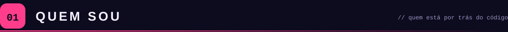

<table>
<tr>
<td width="62%" valign="middle">
  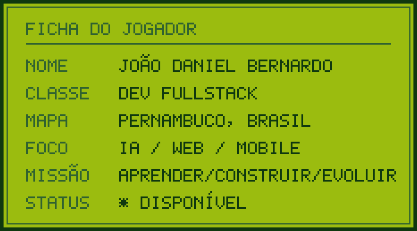
</td>
<td width="38%" align="center" valign="middle">
  
</td>
</tr>
</table>

 

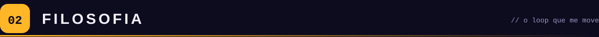

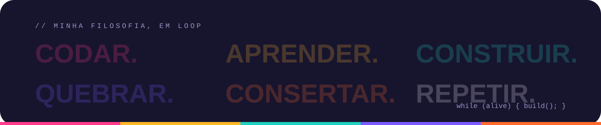

 

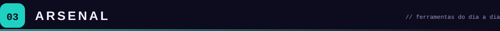

<b>FRONT &amp; MOBILE</b> 

<b>BACK &amp; DADOS</b> 

<b>IA &amp; VISÃO</b> 

<b>FLUXO &amp; FERRAMENTAS</b> 

 

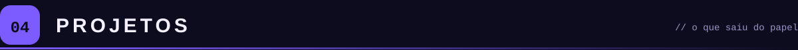

<table>
<tr>
<td width="50%"></td>
<td width="50%"><a href="https://github.com/Index-ProgramaDev/WorkUp">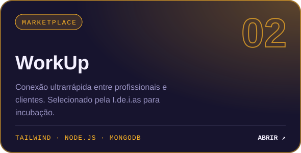</a></td>
</tr>
<tr>
<td width="50%"><a href="https://github.com/SEU_USUARIO/TEAcolhe">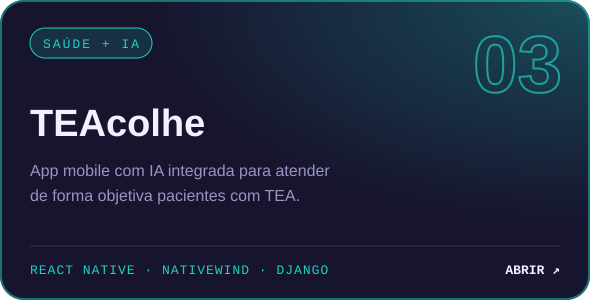</a></td>
<td width="50%"></td>
</tr>
</table>

 

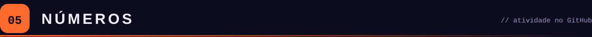

  

 

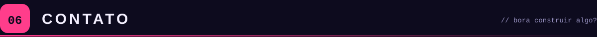

 

