

 

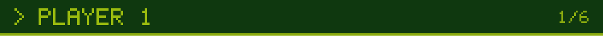

<table>
<tr>
<td width="68%" valign="middle">
  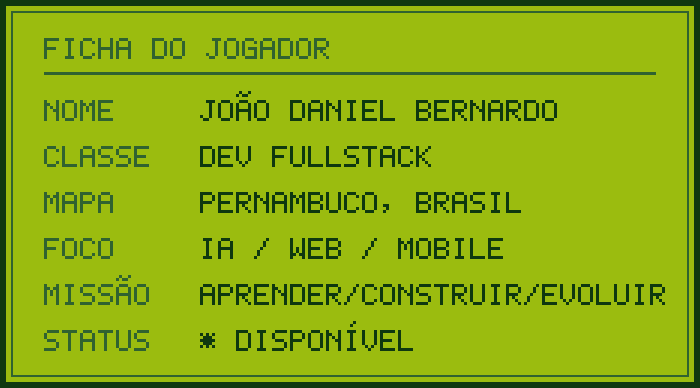
</td>
<td width="32%" align="center" valign="middle">
  
</td>
</tr>
</table>

 

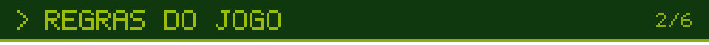

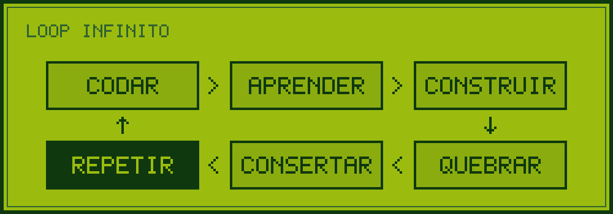

 

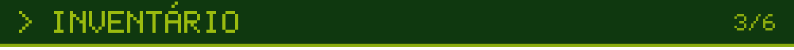

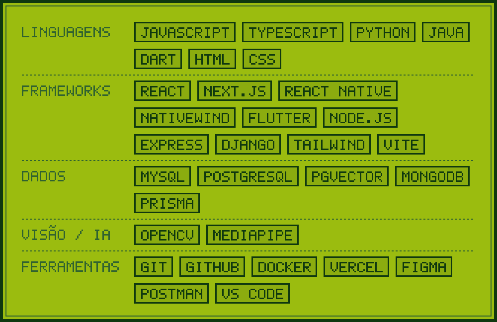

 

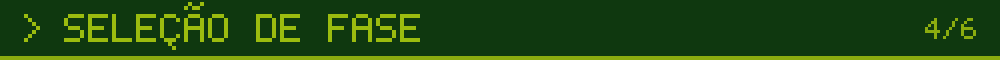

<table>
<tr>
<td width="50%"><a href="https://github.com/Index-ProgramaDev/Cam-Security">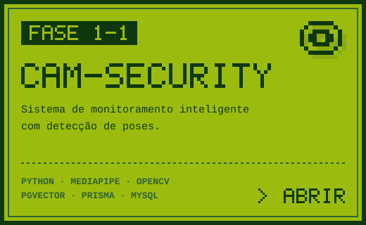</a></td>
<td width="50%"></td>
</tr>
<tr>
<td width="50%"></td>
<td width="50%">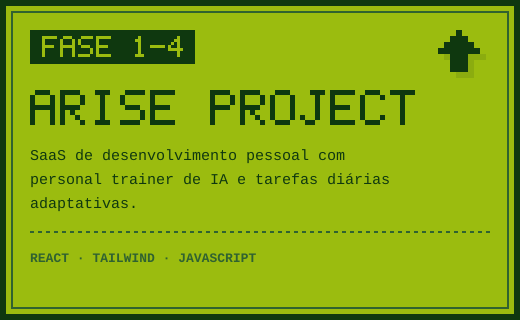</td>
</tr>
</table>

 

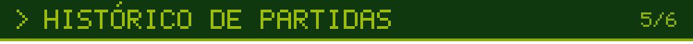

<picture>
  <source media="(prefers-color-scheme: dark)" srcset="https://raw.githubusercontent.com/Index-ProgramaDev/Index-ProgramaDev/output/github-snake-dark.svg"/>
  <source media="(prefers-color-scheme: light)" srcset="https://raw.githubusercontent.com/Index-ProgramaDev/Index-ProgramaDev/output/github-snake.svg"/>
  
</picture>

 

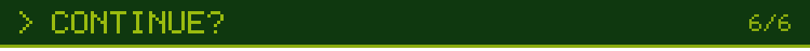

<a href="https://www.linkedin.com/in/SEU_LINKEDIN">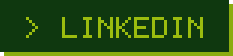</a>
<a href="https://www.instagram.com/SEU_INSTAGRAM">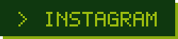</a>

<a href="https://github.com/SEU_USUARIO">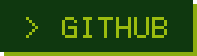</a>

 

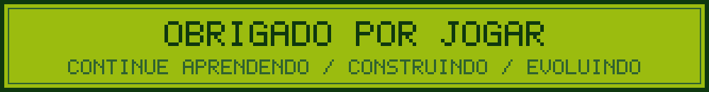
